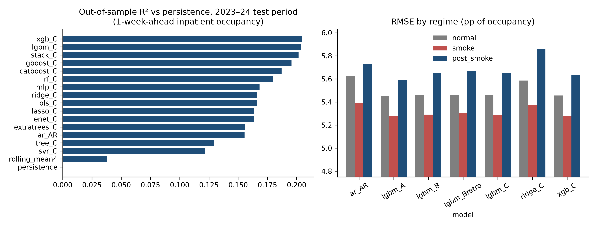

# ML for Healthcare Demand Prediction

**Forecasting hospital bed occupancy and emergency department volume one week ahead, and testing whether wildfire-smoke information improves the forecast.**

Author: Mahyar Rezazadeh (PhD Candidate in Economics, Simon Fraser University) · [mahyarrezazadeh.github.io](https://mahyarrezazadeh.github.io/)

---

## The question

Hospital managers plan beds and staff about a week ahead. Two questions matter for that planning:

1. **How accurately can next week's occupancy be forecast**, and how much do machine-learning models add over the simple rules a planner would use anyway?
2. **Does an external shock signal help?** Wildfire smoke is a visible, forecastable shock that is widely assumed to strain hospitals. If that is true, smoke data should improve the forecast and smoke should raise occupancy.

This project answers both with public data on about 2,800 US short-term hospitals (August 2020 to April 2024), linked to wildfire-smoke exposure built from air monitors and satellite smoke plumes.

## Results in one table

One-week-ahead forecast of inpatient bed occupancy (percentage points). Test period: January 2023 to April 2024, never used for tuning. 68,237 hospital-weeks from a fixed random sample of 1,000 hospitals.

| Model | Inputs | RMSE | Squared-error reduction vs no-change forecast | vs autoregression |
|---|---|---|---|---|
| No-change forecast | this week's occupancy | 6.12 | – | – |
| Pooled autoregression | 4 lags + hospital mean | 5.62 | 15.6% | – |
| Ridge | lags, calendar, weather, smoke, smoke history | 5.59 | 16.6% | 1.2% |
| **LightGBM** | **lags and calendar only** | **5.45** | **20.6%** | **6.0%** |
| LightGBM | + weather and smoke | 5.46 | 20.4% | 5.7% |
| LightGBM | + county smoke history | 5.46 | 20.4% | 5.7% |
| XGBoost | lags and calendar only | 5.45 | 20.7% | 6.1% |

Run `python examples/reproduce_headline_metrics.py` to recompute the first six rows from the tracked predictions in a few seconds.

**What the results say**

- **Boosted trees give a real but modest gain.** They cut squared error by about 21% against a no-change forecast and 6% against an autoregression (clustered Diebold–Mariano p < 0.001). The gain is stable across a rolling window, held-out census divisions and held-out hospitals.
- **The gain comes from the hospital's own recent history.** Adding weather and smoke features does not lower the error: LightGBM's squared error rises by 0.35% overall and 0.48% in smoke weeks. Even the smoke actually realised in the target week does not help.
- **Smoke does not raise occupancy.** In panel regressions on a held-out sample, a 10 µg/m³ increase in weekly smoke PM2.5 changes occupancy by −0.06 percentage points (95% CI −0.21 to 0.10; mean occupancy is 70%). An earlier-period estimate of −1.27 points looked significant, passed standard robustness checks, and did not replicate.
- **Simple rules are hard to beat for alerts.** For flagging weeks above a hospital's own 90th percentile, the no-change forecast has the best F1 (0.73, against 0.65 for LightGBM), because the regression models are tuned for squared error and under-predict peaks. AUROC is about 0.93 for all of them.
- **Forecast intervals are calibrated.** Split-conformal 90% intervals cover 91% of test outcomes, in smoke weeks as well.



Full results, including ICU occupancy, ED visits, the four-week horizon and the Quebec daily series: [docs/results.md](docs/results.md).

## Why this may be useful to a health-system analytics team

- It is an end-to-end, reproducible forecasting pipeline for hospital demand: ingestion from five public sources, feature construction, 13 learner families, walk-forward evaluation, interval calibration and alert detection.
- It reports honestly where machine learning helps and where it does not. The largest practical message is that a strong autoregressive benchmark already captures most of the predictable variation, and that an intuitive external signal added nothing.
- The evaluation design guards against the usual ways a forecasting project overstates itself: a frozen test period, leakage tests, benchmarks that a planner would actually use, and a discovery/held-out split for the causal estimates.

## Quick start

```bash
git clone https://github.com/MahyarRezazadeh/ml-healthcare-demand-forecasting.git
cd ml-healthcare-demand-forecasting

# 1. Check the headline numbers (no data download needed)
pip install -r requirements-quickcheck.txt
python examples/reproduce_headline_metrics.py
pytest -q

# 2. Run the full pipeline (downloads about 3 GB of public data)
pip install -r requirements.txt
python run_pipeline.py --list            # show every stage and command
python run_pipeline.py --stage ingest
python run_pipeline.py --stage build
python run_pipeline.py --stage forecast
python run_pipeline.py --stage causal
python run_pipeline.py --stage report
```

Python 3.13. Raw data go to `data/raw`; set `HDF_RAW_DIR` to store them elsewhere. Three small county covariate files must be placed by hand before the `build` stage; see [docs/data.md](docs/data.md).

## Repository layout

```
run_pipeline.py            stage runner (ingest, build, forecast, causal, report, quebec)
src/
  config.py                paths, random seed, sample dates, thresholds
  features.py              forecast feature sets A-D and the hospital sample
  01-09_*.py               download, cleaning, smoke exposure, analysis panel
  10-14_*.py               tuning, walk-forward forecasts, evaluation, validation designs
  20-24_*.py               panel regressions, event study, double ML, result tables
  30_figures.py            all figures
examples/                  recompute headline metrics from tracked predictions
tests/                     leakage tests for the feature builder; consistency of reported results
results/                   every estimate and metric as CSV (forecasting, causal, descriptive, robustness)
reports/                   figures and tables
docs/                      methodology, data, results, model card, limitations, pre-specified protocol
```

## Documentation

| File | Content |
|---|---|
| [docs/methodology.md](docs/methodology.md) | Features, models, walk-forward design, tests, causal design |
| [docs/data.md](docs/data.md) | Sources, access, cleaning rules, variable definitions |
| [docs/results.md](docs/results.md) | All result tables with the file each number comes from |
| [docs/model_card.md](docs/model_card.md) | Intended use, performance, limits of the recommended model |
| [docs/limitations_and_next_steps.md](docs/limitations_and_next_steps.md) | What the project does not show and what would improve it |
| [docs/protocol/](docs/protocol/) | Protocol written before outcome data were opened, amendments, data-quality report |

## Main limitations

- The data are weekly and every week falls in the pandemic reporting period. Weekly occupancy can miss congestion that lasts a few days.
- Forecasts use a random sample of 1,000 hospitals because the full sample did not fit in 8 GB of memory. Hyperparameters were tuned on the full pre-2023 sample.
- The public file has no cause-specific visits, waiting times or discharges, so the forecast target is total load, not respiratory demand.
- The data are from the United States (and one exploratory Quebec series). Nothing here was estimated on British Columbia data.

## Verification status

The scripts in `src/` are the ones that produced the results, moved into this layout with only path changes. In this layout I re-ran the evaluation step (`12_evaluate_forecasts.py occ 1`: output files identical to the originals), two forecasting models from scratch (`ols_A`, `ar_AR`: predictions identical), the figure script, and the tests. The download, build, tuning and remaining model runs were not re-run after the move.

## Licence

Code: MIT. Data: public sources listed in [docs/data.md](docs/data.md), each under its own terms.
