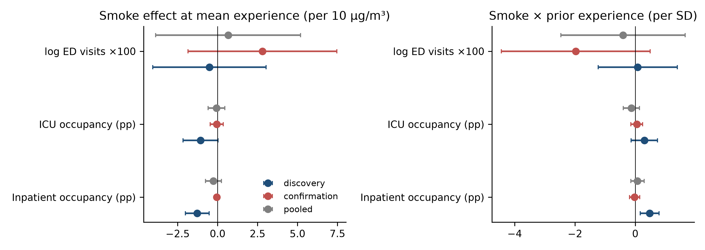

# Results

Every number below is read from a file in `results/`. "Reduction" means 1 − MSE(model) / MSE(benchmark) in the test period (target weeks January 2023 to April 2024) unless stated otherwise. Feature sets A–D are defined in [methodology.md](methodology.md).

## 1. Forecast accuracy, inpatient occupancy, one week ahead

Source: `results/forecasting/metrics_occ_h1.csv`. 68,237 hospital-weeks, 1,000 hospitals. RMSE in percentage points of occupancy.

| Model (feature set) | RMSE | MAE | Reduction vs no-change | Reduction vs autoregression | RMSE, smoke weeks (n = 2,421) |
|---|---|---|---|---|---|
| XGBoost (A) | 5.447 | 3.606 | 20.7% | 6.1% | 5.279 |
| LightGBM (A) | 5.449 | 3.608 | 20.6% | 6.0% | 5.278 |
| LightGBM (D) | 5.452 | 3.614 | 20.6% | 5.9% | 5.275 |
| LightGBM (B) | 5.458 | 3.616 | 20.4% | 5.7% | 5.291 |
| LightGBM (C) | 5.459 | 3.617 | 20.4% | 5.7% | 5.287 |
| Stacking ensemble (C) | 5.465 | 3.644 | 20.2% | 5.5% | 5.284 |
| Histogram gradient boosting (A) | 5.472 | 3.631 | 20.0% | 5.2% | 5.300 |
| CatBoost (A) | 5.497 | 3.654 | 19.2% | 4.4% | 5.341 |
| Random forest (A) | 5.525 | 3.657 | 18.4% | 3.4% | 5.305 |
| MLP (A) | 5.538 | 3.717 | 18.0% | 3.0% | 5.355 |
| OLS / ridge (A) | 5.580 | 3.736 | 16.8% | 1.5% | 5.356 |
| Lasso / elastic net (A) | 5.584 | 3.743 | 16.7% | 1.3% | 5.364 |
| Autoregression with seasonal terms | 5.607 | 3.740 | 16.0% | 0.5% | 5.382 |
| Extra trees (A) | 5.619 | 3.705 | 15.6% | 0.1% | 5.378 |
| **Pooled autoregression** | 5.621 | 3.746 | 15.6% | – | 5.390 |
| SVR (A) | 5.628 | 3.712 | 15.4% | −0.2% | 5.384 |
| Decision tree (A) | 5.711 | 3.815 | 12.8% | −3.2% | 5.416 |
| 4-week rolling mean | 5.996 | 3.931 | 3.8% | −14.0% | 5.876 |
| **No-change forecast** | 6.117 | 3.990 | – | −18.4% | 5.892 |
| Historical mean | 11.262 | 8.088 | −239% | −301% | 11.721 |
| Seasonal naive | 13.155 | 8.795 | −363% | −448% | 13.809 |

Week-block bootstrap 95% interval for the LightGBM (A) reduction against the no-change forecast: 18.7% to 22.7% (`r2_bootstrap_occ_h1.csv`).

Single-split comparisons (`extra_neural.csv`, `extra_ts.csv`): GRU 17.7%, TCN 17.4%, LSTM 17.3% against the no-change forecast. On a 150-hospital subsample, per-hospital ARIMA gives 13.7%, Prophet is worse than the no-change forecast, and Prophet + XGBoost gives 16.7%.

## 2. Does smoke information improve the forecast?

Source: `results/forecasting/incremental_occ_h1.csv`. Same learner, same observations, larger feature set against smaller. A positive value means the larger set has lower squared error.

| Learner | Step | All weeks | Smoke weeks | Test |
|---|---|---|---|---|
| LightGBM | A → B (add weather and smoke) | −0.35% | −0.48% | DM p = 0.99 / 0.89 |
| LightGBM | B → C (add county smoke history) | 0.00% | +0.15% | DM p = 0.51 / 0.32 |
| LightGBM | C → D (add capacity and county characteristics) | +0.26% | +0.44% | DM p < 0.001 |
| LightGBM | A → B-retro (smoke realised in the target week) | −0.48% | −1.11% | DM p = 1.00 |
| OLS | A → B | −0.22% | −0.59% | Clark–West p = 0.88 / 0.82 |
| OLS | B → C | −0.04% | −0.07% | Clark–West p = 0.60 / 0.43 |

Smoke and weather features do not improve the forecast. They make it slightly worse, including when the model is given the smoke that was actually realised in the target week. Only the capacity and county-characteristics block adds a small amount for LightGBM.

Squared forecast errors are not larger in smoke weeks (LightGBM: −2.1, SE 2.1, against a mean of 30; `h6_h7_tests_occ_h1.csv`).

## 3. Other targets and horizons

Sources: `metrics_occ_h4.csv`, `metrics_icu_occ_h1.csv`, `metrics_l_ed_h1.csv`. Reduced learner set (OLS, ridge, LightGBM).

| Target | Best model | RMSE | Reduction vs no-change | Reduction vs autoregression |
|---|---|---|---|---|
| Inpatient occupancy, 4 weeks ahead | LightGBM (A) | 7.02 pp | 22.0% | 3.9% |
| ICU occupancy, 1 week ahead | LightGBM (A) | 7.32 pp | 21.1% | 4.6% |
| log ED visits, 1 week ahead (to June 2023, n = 22,984) | OLS / ridge (C) | 0.141 | 11.3% | 2.7% |

At the four-week horizon the 4-week rolling mean (17.2% against the no-change forecast) is close to the autoregression (18.8%).

## 4. Stability of the gain

Sources: `extra_rolling.csv`, `extra_lodo.csv`, `extra_lho.csv`. LightGBM (A), reduction against the no-change forecast.

| Design | Result |
|---|---|
| Expanding window (main) | 20.6% |
| Rolling 104-week window | 20.6% |
| Hospitals never seen in training (5-fold) | 19.4% |
| Census division never seen in training | 13.8% (Pacific) to 23.4% (West North Central) |

## 5. Intervals and alerts

Split-conformal 90% intervals (`intervals_occ_h1.csv`): LightGBM (C) covers 91.4% of test outcomes overall and 90.9% in smoke weeks, with a width of 17.8 points. The no-change forecast needs 19.1 points for the same coverage.

Detecting weeks above the hospital's own 90th percentile of pre-2023 occupancy (`detection_occ_h1.csv`; base rate 18.4%):

| Model | AUROC | PR-AUC | Precision | Recall | F1 |
|---|---|---|---|---|---|
| No-change forecast | 0.921 | 0.750 | 0.733 | 0.730 | 0.732 |
| Pooled autoregression | 0.925 | 0.767 | 0.778 | 0.524 | 0.626 |
| LightGBM (A) | 0.930 | 0.783 | 0.794 | 0.548 | 0.648 |

The regression models rank weeks slightly better but shrink forecasts toward the mean, so at the fixed threshold they miss more high weeks. An alerting product would need a classification model or a recalibrated threshold.

## 6. Does smoke change hospital load? Panel regressions

Source: `results/causal/usw_all_results_adjusted.csv`, main specification. Effect of a 10 µg/m³ increase in weekly mean smoke PM2.5.

| Outcome | Estimated to Dec 2022 | Held-out, Jan 2023 – Apr 2024 |
|---|---|---|
| Inpatient occupancy (pp) | −1.27 (SE 0.38, p = 0.002) | −0.06 (SE 0.08, p = 0.47) |
| ICU occupancy (pp) | −1.06 (SE 0.56, p = 0.06) | −0.05 (SE 0.21, p = 0.82) |
| log ED visits | −0.005 (SE 0.018, p = 0.78) | 0.028 (SE 0.024, p = 0.24) |
| Occupancy × county smoke history (per SD) | 0.48 (SE 0.16, p = 0.005) | −0.02 (SE 0.09, p = 0.81) |

- The first-period occupancy estimate survives a Holm correction (p = 0.009) but not the held-out sample.
- It also fails pre-trend checks: in the stacked event study the coefficients four and three weeks before the first severe smoke week are −0.86 and −0.48 (`usw_stacked_event_study.csv`).
- The interaction with smoke history is 0.01 within eastern states and 0.20 within western states, neither significant. It is a regional difference, not a history effect.
- Double machine learning (`usw_dml_results.csv`): −0.58 (SE 0.26) in the first period, 0.15 (SE 0.22) in the held-out period.

## 7. Quebec emergency departments (exploratory)

Daily stretcher occupancy, 115 emergency departments, one smoke season. Source: `results/forecasting/qcd_metrics.csv`, `results/causal/qcd_results.csv`.

| Horizon | Best model | Reduction vs no-change | Effect of adding smoke (LightGBM, A → B) |
|---|---|---|---|
| 1 day | LightGBM (A) | 24.4% | −0.3% |
| 3 days | OLS (A) | 40.8% | −0.4% |
| 7 days | OLS (A) | 39.4% | −0.3% |

Same-day smoke PM2.5 has no significant effect on stretcher occupancy (0.25 points per 10 µg/m³, SE 0.24). For linear models, adding smoke features clearly lowers accuracy on smoke days (one day ahead, the reduction against the no-change forecast falls from 22.8% to 13.5%).

## Figures

All figures are in `reports/figures/` and are produced by `src/30_figures.py`.

| Figure | Content |
|---|---|
| fig01 | Smoke exposure over time and distribution of county smoke history |
| fig02 | Regression estimates, first period against held-out period |
| fig03 | Leads and lags of smoke |
| fig04 | Stacked event study |
| fig05 | Robustness of the occupancy estimates |
| fig06, fig07 | Quebec: distributed lags; occupancy and smoke in summer 2023 |
| fig08 | Forecast model comparison |
| fig09 | Incremental value of each feature block |
| fig10 | Actual against predicted, and errors by regime |
| fig11 | Forecast accuracy by county smoke history |
